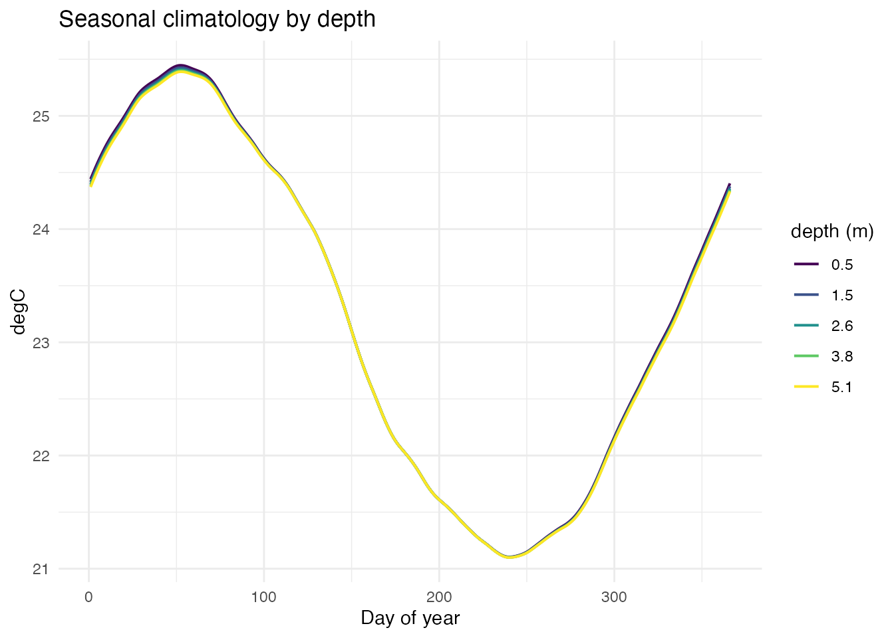
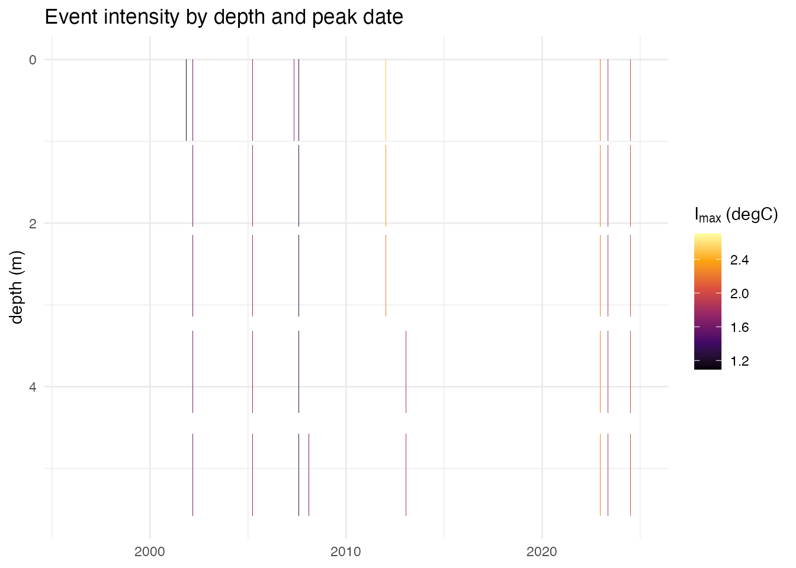
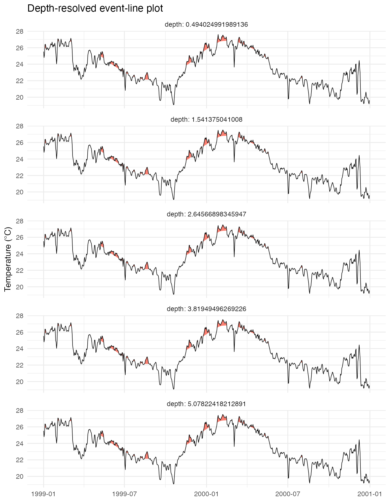
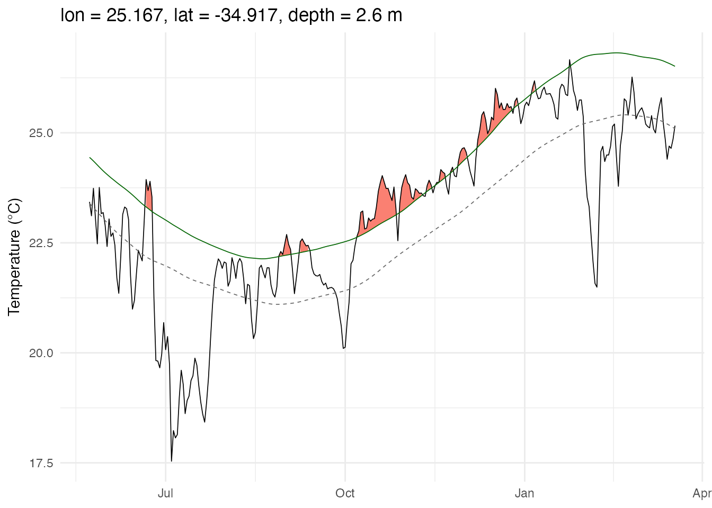
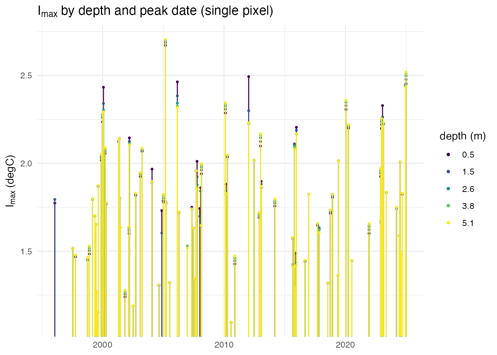

# Depth-resolved (4D) marine heatwave analysis

## Overview

Ocean reanalyses and models such as GLORYS12 provide temperature on a 4D
grid (`lon`, `lat`, `depth`, `time`), not just at the sea surface.
**heatwave3** can compute climatologies and detect events natively
across a **contiguous band of depth levels**, producing one 4D
climatology/event NetCDF instead of per-level 3D files.

Every chunk in this vignette runs against a tiny 2x2 pixel, 5
depth-level GLORYS12 fixture bundled with the package
(`system.file("extdata/glorys_depth_test.nc", package = "heatwave3")`) –
the same one used by the test suite – so that this vignette actually
compiles when the documentation is built. Everything shown works
identically on a full-resolution file with many more pixels and depth
levels; just substitute your own `temp_file`. The trade-off of the small
fixture is scale, not behaviour: with only 4 horizontal pixels and 5
depth levels (0.49-5.08 m, all within the mixed layer), don’t expect
dramatic spatial or vertical structure in the figures below.

\
[`library`](https://rdrr.io/r/base/library.html)`(`[`heatwave3`](https://robwschlegel.github.io/heatwave3/)`)`\
\
`temp_file`` ``<-`` `[`system.file`](https://rdrr.io/r/base/system.file.html)`(``"extdata/glorys_depth_test.nc"``, package ``=`` ``"heatwave3"``)`\
`clim_period`` ``<-`` `[`c`](https://rdrr.io/r/base/c.html)`(``"1993-01-01"``, ``"2019-12-31"``)`

## Two ways to work across depth

### Option A: per-level looping

Before `depth_range` existed, the only way to get per-depth results was
to run the ordinary 3D pipeline once per level, squeezing to a single
depth index each time with the existing `depth` argument. This is still
a legitimate, simple approach: it can be run in parallel across depth
and reuses the same validated 3D code path as every other heatwave3
analysis.

\
`n_depth`` ``<-`` ``5L``  ``# number of depth levels in this fixture`\
\
`depth_indices`` ``<-`` `[`seq_len`](https://rdrr.io/r/base/seq.html)`(``n_depth``)`` ``-`` ``1L``  ``# depth= is a 0-based index: 0, 1, 2, 3, 4`\
`purrr``::`[`walk`](https://purrr.tidyverse.org/reference/map.html)`(``depth_indices``, \``(``k``)`` ``{`\
`  `[`detect3`](https://robwschlegel.github.io/heatwave3/reference/detect3.md)`(``temp_file``, name ``=`` `[`file.path`](https://rdrr.io/r/base/file.path.html)`(`[`tempdir`](https://rdrr.io/r/base/tempfile.html)`(``)``, `[`paste0`](https://rdrr.io/r/base/paste.html)`(``"mhw_z"``, ``k``)``)``,`\
`          climatologyPeriod ``=`` ``clim_period``,`\
`          depth ``=`` ``k``, category ``=`` ``TRUE``, quiet ``=`` ``TRUE``)`\
`}``)`

The trade-off: this produces `n_depth` separate pairs of `_clim.nc`/
`_events.nc` files, each with `n_depth`-fold repeated I/O over the same
lon/lat/time grid, and there is no vertical linkage between levels (each
is detected completely independently, as if it were its own 3D dataset).
For users who just want “climatology and events at 20 m, 50 m, 100 m…”
this may already be enough – stack the files yourself downstream with
`terra` (R), `xarray` (python), or `CDO` (bash).

### Option B: native `depth_range` (recommended)

`depth_range = c(min_depth, max_depth)` (metres, inclusive) tells
[`ts2clm3()`](https://robwschlegel.github.io/heatwave3/reference/ts2clm3.md)
and
[`detect3()`](https://robwschlegel.github.io/heatwave3/reference/detect3.md)
to read every depth level whose coordinate falls in that range and
compute an independent climatology/event table for every
`(lon, lat, depth)` triple, in **one** call producing **one** 4D file.
This avoids the repeated I/O and per-level file bookkeeping of Option A
above. The fixture’s 5 levels all fall within 0-10 m:

\
`stem`` ``<-`` `[`file.path`](https://rdrr.io/r/base/file.path.html)`(`[`tempdir`](https://rdrr.io/r/base/tempfile.html)`(``)``, ``"mhw4d"``)`\
`clim_file`` ``<-`` `[`ts2clm3`](https://robwschlegel.github.io/heatwave3/reference/ts2clm3.md)`(``file_in ``=`` ``temp_file``,`\
`                     name ``=`` ``stem``,`\
`                     climatologyPeriod ``=`` ``clim_period``,`\
`                     depth_range ``=`` `[`c`](https://rdrr.io/r/base/c.html)`(``0``, ``10``)``,`\
`                     n_threads ``=`` ``2``)`\
`#> Reading SST data from /Users/rschlegel/Library/R/arm64/4.6/library/heatwave3/extdata/glorys_depth_test.nc...`\
`#> Grid: 2 lon x 2 lat x 5 depth x 11688 time = 20 pixels`\
`#> Computing climatology with 2 thread(s)...`\
`#>   20/20 pixels (100%)`\
`#> Writing climatology to /var/folders/w8/8kw9l4sx1v57nx6l9s0rrklw0000gp/T//RtmpF2BZly/mhw4d_clim.nc...`\
`#> Done.`\
`#> `\
`#> ------------------------------------------------------------------`\
`#> Climatology written to: /var/folders/w8/8kw9l4sx1v57nx6l9s0rrklw0000gp/T//RtmpF2BZly/mhw4d_clim.nc`\
`#> Rows (long format): 7,320   grid: 2 lon x 2 lat`\
`#> `\
`#> Head:`\
`#>        lon       lat doy    seas  thresh    depth`\
`#> 1 25.16667 -34.91667   1 24.4399 25.7963 0.494025`\
`#> 2 25.16667 -34.91667   2 24.4776 25.8311 0.494025`\
`#> 3 25.16667 -34.91667   3 24.5145 25.8679 0.494025`\
`#> 4 25.16667 -34.91667   4 24.5506 25.9044 0.494025`\
`#> 5 25.16667 -34.91667   5 24.5857 25.9402 0.494025`\
`#> `\
`#> Tail:`\
`#>        lon       lat doy    seas  thresh    depth`\
`#> 7316 25.25 -34.83333 362 24.0061 25.4965 5.078224`\
`#> 7317 25.25 -34.83333 363 24.0422 25.5364 5.078224`\
`#> 7318 25.25 -34.83333 364 24.0788 25.5742 5.078224`\
`#> 7319 25.25 -34.83333 365 24.1164 25.6112 5.078224`\
`#> 7320 25.25 -34.83333 366 24.1542 25.6515 5.078224`\
`#> `\
`#> Summary:`\
`#>   ocean pixels (valid climatology): 4`\
`#>   seas:   20.98 to 25.55`\
`#>   thresh:    22 to 26.92`\
`#> `\
`#> Examine with  hw3_export("/var/folders/w8/8kw9l4sx1v57nx6l9s0rrklw0000gp/T//RtmpF2BZly/mhw4d_clim.nc", n = 20)`\
`#> or export with hw3_export("/var/folders/w8/8kw9l4sx1v57nx6l9s0rrklw0000gp/T//RtmpF2BZly/mhw4d_clim.nc", file_out = "out.csv")  (.csv/.rds/.parquet)`\
`#> ------------------------------------------------------------------`

[`detect_event3()`](https://robwschlegel.github.io/heatwave3/reference/detect_event3.md)
needs no separate depth argument at all: it reads the depth range
straight back out of the climatology file it is already loading, so
climatology and event detection can never end up out of sync about which
levels they are comparing.

\
`event_file`` ``<-`` `[`detect_event3`](https://robwschlegel.github.io/heatwave3/reference/detect_event3.md)`(``file_in ``=`` ``temp_file``,`\
`                            name ``=`` ``stem``,`\
`                            category ``=`` ``TRUE``,`\
`                            n_threads ``=`` ``2``, `\
`                            quiet ``=`` ``TRUE``)`

Or as a single call via
[`detect3()`](https://robwschlegel.github.io/heatwave3/reference/detect3.md):

\
[`detect3`](https://robwschlegel.github.io/heatwave3/reference/detect3.md)`(``file_in ``=`` ``temp_file``,`\
`        name ``=`` ``stem``,`\
`        climatologyPeriod ``=`` ``clim_period``,`\
`        depth_range ``=`` `[`c`](https://rdrr.io/r/base/c.html)`(``0``, ``10``)``,`\
`        category ``=`` ``TRUE``,`\
`        n_threads ``=`` ``2``)`\
`#> Reading SST data from /Users/rschlegel/Library/R/arm64/4.6/library/heatwave3/extdata/glorys_depth_test.nc...`\
`#> Grid: 2 lon x 2 lat x 5 depth x 11688 time = 20 pixels`\
`#> Computing climatology with 2 thread(s)...`\
`#>   20/20 pixels (100%)`\
`#> Writing climatology to /var/folders/w8/8kw9l4sx1v57nx6l9s0rrklw0000gp/T//RtmpF2BZly/mhw4d_clim.nc...`\
`#> Done.`\
`#> `\
`#> ------------------------------------------------------------------`\
`#> Climatology written to: /var/folders/w8/8kw9l4sx1v57nx6l9s0rrklw0000gp/T//RtmpF2BZly/mhw4d_clim.nc`\
`#> Rows (long format): 7,320   grid: 2 lon x 2 lat`\
`#> `\
`#> Head:`\
`#>        lon       lat doy    seas  thresh    depth`\
`#> 1 25.16667 -34.91667   1 24.4399 25.7963 0.494025`\
`#> 2 25.16667 -34.91667   2 24.4776 25.8311 0.494025`\
`#> 3 25.16667 -34.91667   3 24.5145 25.8679 0.494025`\
`#> 4 25.16667 -34.91667   4 24.5506 25.9044 0.494025`\
`#> 5 25.16667 -34.91667   5 24.5857 25.9402 0.494025`\
`#> `\
`#> Tail:`\
`#>        lon       lat doy    seas  thresh    depth`\
`#> 7316 25.25 -34.83333 362 24.0061 25.4965 5.078224`\
`#> 7317 25.25 -34.83333 363 24.0422 25.5364 5.078224`\
`#> 7318 25.25 -34.83333 364 24.0788 25.5742 5.078224`\
`#> 7319 25.25 -34.83333 365 24.1164 25.6112 5.078224`\
`#> 7320 25.25 -34.83333 366 24.1542 25.6515 5.078224`\
`#> `\
`#> Summary:`\
`#>   ocean pixels (valid climatology): 4`\
`#>   seas:   20.98 to 25.55`\
`#>   thresh:    22 to 26.92`\
`#> `\
`#> Examine with  hw3_export("/var/folders/w8/8kw9l4sx1v57nx6l9s0rrklw0000gp/T//RtmpF2BZly/mhw4d_clim.nc", n = 20)`\
`#> or export with hw3_export("/var/folders/w8/8kw9l4sx1v57nx6l9s0rrklw0000gp/T//RtmpF2BZly/mhw4d_clim.nc", file_out = "out.csv")  (.csv/.rds/.parquet)`\
`#> ------------------------------------------------------------------`\
`#> Reading climatology from /var/folders/w8/8kw9l4sx1v57nx6l9s0rrklw0000gp/T//RtmpF2BZly/mhw4d_clim.nc...`\
`#> Reading SST data from /Users/rschlegel/Library/R/arm64/4.6/library/heatwave3/extdata/glorys_depth_test.nc...`\
`#> Grid: 2 lon x 2 lat x 5 depth x 11688 time = 20 pixels`\
`#> Detecting events with 2 thread(s)...`\
`#>   20/20 pixels (100%)`\
`#> Found 1611 events across 20 pixels`\
`#> Writing events to /var/folders/w8/8kw9l4sx1v57nx6l9s0rrklw0000gp/T//RtmpF2BZly/mhw4d_events.nc...`\
`#> Done.`\
`#> `\
`#> ------------------------------------------------------------------`\
`#> Events written to: /var/folders/w8/8kw9l4sx1v57nx6l9s0rrklw0000gp/T//RtmpF2BZly/mhw4d_events.nc`\
`#> Rows (long format): 1,611`\
`#> `\
`#> Head:`\
`#>        lon       lat pixel_index event_no date_start  date_peak   date_end`\
`#> 1 25.16667 -34.91667           0        1 1996-01-21 1996-01-24 1996-01-26`\
`#> 2 25.16667 -34.91667           0        2 1997-07-18 1997-07-21 1997-07-22`\
`#> 3 25.16667 -34.91667           0        3 1997-10-03 1997-10-10 1997-10-12`\
`#> 4 25.16667 -34.91667           0        4 1998-11-23 1998-11-27 1998-11-27`\
`#> 5 25.16667 -34.91667           0        5 1999-05-09 1999-05-12 1999-05-15`\
`#>   duration intensity_mean intensity_max intensity_var intensity_cumulative`\
`#> 1        6         1.5865        1.7736        0.1317               9.5189`\
`#> 2        5         1.2510        1.5161        0.2516               6.2549`\
`#> 3       10         1.2946        1.4676        0.1200              12.9463`\
`#> 4        5         1.2410        1.4843        0.1530               6.2048`\
`#> 5        7         1.4740        1.6994        0.1584              10.3179`\
`#>   intensity_mean_relThresh intensity_max_relThresh intensity_var_relThresh`\
`#> 1                   0.1453                  0.3288                  0.1244`\
`#> 2                   0.2992                  0.5704                  0.2586`\
`#> 3                   0.2006                  0.3803                  0.1188`\
`#> 4                   0.1795                  0.4009                  0.1383`\
`#> 5                   0.4610                  0.6895                  0.1601`\
`#>   intensity_cumulative_relThresh intensity_mean_abs intensity_max_abs`\
`#> 1                         0.8717            26.6664           26.8669`\
`#> 2                         1.4958            22.8343           23.0860`\
`#> 3                         2.0058            22.8490           23.0794`\
`#> 4                         0.8976            24.3392           24.6432`\
`#> 5                         3.2267            25.3127           25.5404`\
`#>   intensity_var_abs intensity_cumulative_abs rate_onset rate_decline    depth`\
`#> 1            0.1634                 159.9986     0.1369       0.1066 0.494025`\
`#> 2            0.2383                 114.1717     0.1866       0.4032 0.494025`\
`#> 3            0.1284                 228.4898     0.0329       0.1731 0.494025`\
`#> 4            0.1960                 121.6961     0.0922       0.4085 0.494025`\
`#> 5            0.1680                 177.1892     0.1753       0.1619 0.494025`\
`#>     category p_moderate p_strong p_severe p_extreme season`\
`#> 1 I Moderate        100        0        0         0 Summer`\
`#> 2 I Moderate        100        0        0         0 Winter`\
`#> 3 I Moderate        100        0        0         0 Spring`\
`#> 4 I Moderate        100        0        0         0 Spring`\
`#> 5 I Moderate        100        0        0         0   Fall`\
`#> `\
`#> Tail:`\
`#>        lon       lat pixel_index event_no date_start  date_peak   date_end`\
`#> 1607 25.25 -34.83333          18       79 2024-06-23 2024-06-25 2024-07-01`\
`#> 1608 25.25 -34.83333          18       80 2024-07-15 2024-07-19 2024-07-28`\
`#> 1609 25.25 -34.83333          18       81 2024-08-07 2024-08-20 2024-09-03`\
`#> 1610 25.25 -34.83333          18       82 2024-12-08 2024-12-08 2024-12-14`\
`#> 1611 25.25 -34.83333          18       83 2024-12-18 2024-12-23 2024-12-29`\
`#>      duration intensity_mean intensity_max intensity_var intensity_cumulative`\
`#> 1607        9         1.5017        1.6836        0.1564              13.5150`\
`#> 1608       14         1.1987        1.6393        0.1932              16.7822`\
`#> 1609       28         1.4298        2.3913        0.3482              40.0337`\
`#> 1610        7         2.0257        2.4800        0.4032              14.1799`\
`#> 1611       12         2.0800        2.3821        0.2662              24.9601`\
`#>      intensity_mean_relThresh intensity_max_relThresh intensity_var_relThresh`\
`#> 1607                   0.3836                  0.5506                  0.1543`\
`#> 1608                   0.2597                  0.6807                  0.1793`\
`#> 1609                   0.4674                  1.4444                  0.3469`\
`#> 1610                   0.7980                  1.2835                  0.4274`\
`#> 1611                   0.6432                  0.9547                  0.2627`\
`#>      intensity_cumulative_relThresh intensity_mean_abs intensity_max_abs`\
`#> 1607                         3.4525            23.4180           23.6375`\
`#> 1608                         3.6362            22.7199           23.1878`\
`#> 1609                        13.0874            22.5690           23.5094`\
`#> 1610                         5.5863            25.5139           25.8759`\
`#> 1611                         7.7183            25.9767           26.2589`\
`#>      intensity_var_abs intensity_cumulative_abs rate_onset rate_decline`\
`#> 1607            0.1754                 210.7624     0.1927       0.1080`\
`#> 1608            0.2205                 318.0784     0.1454       0.0814`\
`#> 1609            0.3456                 631.9313     0.0981       0.0854`\
`#> 1610            0.3446                 178.5976     1.3979       0.2349`\
`#> 1611            0.2882                 311.7206     0.1818       0.1543`\
`#>         depth   category p_moderate p_strong p_severe p_extreme season`\
`#> 1607 3.819495 I Moderate        100        0        0         0 Winter`\
`#> 1608 3.819495 I Moderate        100        0        0         0 Winter`\
`#> 1609 3.819495  II Strong         82        7        0         0 Winter`\
`#> 1610 3.819495  II Strong         71       29        0         0 Summer`\
`#> 1611 3.819495 I Moderate        100        0        0         0 Summer`\
`#> `\
`#> Summary:`\
`#>   events: 1611   pixels with events: 4`\
`#>   dates:  1996-01-21 to 2024-12-29`\
`#>   duration (days):     5 to    34`\
`#>   intensity_max:   0.9695 to 3.165`\
`#>   category: I Moderate=1528  II Strong=83`\
`#> `\
`#> Examine with  hw3_export("/var/folders/w8/8kw9l4sx1v57nx6l9s0rrklw0000gp/T//RtmpF2BZly/mhw4d_events.nc", n = 20)`\
`#> or export with hw3_export("/var/folders/w8/8kw9l4sx1v57nx6l9s0rrklw0000gp/T//RtmpF2BZly/mhw4d_events.nc", file_out = "out.csv")  (.csv/.rds/.parquet)`\
`#> ------------------------------------------------------------------`

## Reading the depth-resolved output

[`hw3_export()`](https://robwschlegel.github.io/heatwave3/reference/hw3_export.md)
surfaces a `depth` column automatically whenever the source file is
depth-resolved:

\
`clim_df``  ``<-`` `[`hw3_export`](https://robwschlegel.github.io/heatwave3/reference/hw3_export.md)`(`[`paste0`](https://rdrr.io/r/base/paste.html)`(``stem``, ``"_clim.nc"``)``)`\
`event_df`` ``<-`` `[`hw3_export`](https://robwschlegel.github.io/heatwave3/reference/hw3_export.md)`(`[`paste0`](https://rdrr.io/r/base/paste.html)`(``stem``, ``"_events.nc"``)``)`\
\
[`head`](https://rdrr.io/r/utils/head.html)`(``clim_df``)`

    #>        lon       lat doy    seas  thresh    depth
    #> 1 25.16667 -34.91667   1 24.4399 25.7963 0.494025
    #> 2 25.16667 -34.91667   2 24.4776 25.8311 0.494025
    #> 3 25.16667 -34.91667   3 24.5145 25.8679 0.494025
    #> 4 25.16667 -34.91667   4 24.5506 25.9044 0.494025
    #> 5 25.16667 -34.91667   5 24.5857 25.9402 0.494025
    #> 6 25.16667 -34.91667   6 24.6193 25.9760 0.494025

\
[`table`](https://rdrr.io/r/base/table.html)`(`[`round`](https://rdrr.io/r/base/Round.html)`(``event_df``$``depth``, ``2``)``)`

    #> 
    #> 0.49 1.54 2.65 3.82 5.08 
    #>  316  322  321  326  326

Because every `(lon, lat, depth)` triple gets its own climatology, the
seasonal cycle and threshold both flatten out with depth – the surface
has the largest seasonal amplitude and the highest threshold, decaying
as you move down through the mixed layer. This is already visible
directly from the exported climatology data frame, with no new plotting
functions required (the effect is subtle here since all 5 levels sit
within the top 5 m; it’s more pronounced across a deeper range on a real
file):

\
[`library`](https://rdrr.io/r/base/library.html)`(`[`ggplot2`](https://ggplot2.tidyverse.org)`)`\
\
`one_pixel`` ``<-`` `[`subset`](https://rdrr.io/r/base/subset.html)`(``clim_df``, ``lon`` ``==`` ``clim_df``$``lon``[``1``]`` ``&`` ``lat`` ``==`` ``clim_df``$``lat``[``1``]``)`\
\
[`ggplot`](https://ggplot2.tidyverse.org/reference/ggplot.html)`(``one_pixel``, `[`aes`](https://ggplot2.tidyverse.org/reference/aes.html)`(``doy``, ``seas``, colour ``=`` `[`factor`](https://rdrr.io/r/base/factor.html)`(`[`round`](https://rdrr.io/r/base/Round.html)`(``depth``, ``1``)``)``)``)`` ``+`\
`  `[`geom_line`](https://ggplot2.tidyverse.org/reference/geom_path.html)`(``linewidth ``=`` ``0.7``)`` ``+`\
`  `[`scale_colour_viridis_d`](https://ggplot2.tidyverse.org/reference/scale_viridis.html)`(``name ``=`` ``"depth (m)"``)`` ``+`\
`  `[`labs`](https://ggplot2.tidyverse.org/reference/labs.html)`(``title ``=`` ``"Seasonal climatology by depth"``, x ``=`` ``"Day of year"``, y ``=`` ``"degC"``)`` ``+`\
`  `[`theme_minimal`](https://ggplot2.tidyverse.org/reference/ggtheme.html)`(``base_size ``=`` ``11``)`

A depth-time Hovmoeller-style view of event intensity is also already
possible by building the plot directly from `event_df`, without any new
graphics functions:

\
`one_pixel_events`` ``<-`` `[`subset`](https://rdrr.io/r/base/subset.html)`(``event_df``, ``lon`` ``==`` ``event_df``$``lon``[``1``]`` ``&`` ``lat`` ``==`` ``event_df``$``lat``[``1``]``)`\
\
[`ggplot`](https://ggplot2.tidyverse.org/reference/ggplot.html)`(``one_pixel_events``, `[`aes`](https://ggplot2.tidyverse.org/reference/aes.html)`(``x ``=`` ``date_peak``, y ``=`` ``depth``, fill ``=`` ``intensity_max``)``)`` ``+`\
`  `[`geom_tile`](https://ggplot2.tidyverse.org/reference/geom_tile.html)`(``height ``=`` ``1``)`` ``+`\
`  `[`scale_fill_viridis_c`](https://ggplot2.tidyverse.org/reference/scale_viridis.html)`(``name ``=`` `[`expression`](https://rdrr.io/r/base/expression.html)`(``I``[``max``]`` ``~`` ``"(degC)"``)``, option ``=`` ``"inferno"``)`` ``+`\
`  `[`scale_y_reverse`](https://ggplot2.tidyverse.org/reference/scale_continuous.html)`(``name ``=`` ``"depth (m)"``)`` ``+`\
`  `[`labs`](https://ggplot2.tidyverse.org/reference/labs.html)`(``title ``=`` ``"Event intensity by depth and peak date"``, x ``=`` ``NULL``)`` ``+`\
`  `[`theme_minimal`](https://ggplot2.tidyverse.org/reference/ggtheme.html)`(``base_size ``=`` ``11``)`

## Depth-resolved event-line plots with `geom_flame3()` / `geom_lolli3()`

The per-day product also carries a depth dimension now, so
`daily = "also"` works together with `depth_range` – no separate depth
argument needed here either, for the same reason
[`detect_event3()`](https://robwschlegel.github.io/heatwave3/reference/detect_event3.md)
doesn’t need one:

\
[`detect3`](https://robwschlegel.github.io/heatwave3/reference/detect3.md)`(``file_in ``=`` ``temp_file``,`\
`        name ``=`` ``stem``,`\
`        climatologyPeriod ``=`` ``clim_period``,`\
`        depth_range ``=`` `[`c`](https://rdrr.io/r/base/c.html)`(``0``, ``10``)``,`\
`        category ``=`` ``TRUE``,`\
`        daily ``=`` ``"also"``,`\
`        n_threads ``=`` ``2``)`\
`#> Reading SST data from /Users/rschlegel/Library/R/arm64/4.6/library/heatwave3/extdata/glorys_depth_test.nc...`\
`#> Grid: 2 lon x 2 lat x 5 depth x 11688 time = 20 pixels`\
`#> Computing climatology with 2 thread(s)...`\
`#>   20/20 pixels (100%)`\
`#> Writing climatology to /var/folders/w8/8kw9l4sx1v57nx6l9s0rrklw0000gp/T//RtmpF2BZly/mhw4d_clim.nc...`\
`#> Done.`\
`#> `\
`#> ------------------------------------------------------------------`\
`#> Climatology written to: /var/folders/w8/8kw9l4sx1v57nx6l9s0rrklw0000gp/T//RtmpF2BZly/mhw4d_clim.nc`\
`#> Rows (long format): 7,320   grid: 2 lon x 2 lat`\
`#> `\
`#> Head:`\
`#>        lon       lat doy    seas  thresh    depth`\
`#> 1 25.16667 -34.91667   1 24.4399 25.7963 0.494025`\
`#> 2 25.16667 -34.91667   2 24.4776 25.8311 0.494025`\
`#> 3 25.16667 -34.91667   3 24.5145 25.8679 0.494025`\
`#> 4 25.16667 -34.91667   4 24.5506 25.9044 0.494025`\
`#> 5 25.16667 -34.91667   5 24.5857 25.9402 0.494025`\
`#> `\
`#> Tail:`\
`#>        lon       lat doy    seas  thresh    depth`\
`#> 7316 25.25 -34.83333 362 24.0061 25.4965 5.078224`\
`#> 7317 25.25 -34.83333 363 24.0422 25.5364 5.078224`\
`#> 7318 25.25 -34.83333 364 24.0788 25.5742 5.078224`\
`#> 7319 25.25 -34.83333 365 24.1164 25.6112 5.078224`\
`#> 7320 25.25 -34.83333 366 24.1542 25.6515 5.078224`\
`#> `\
`#> Summary:`\
`#>   ocean pixels (valid climatology): 4`\
`#>   seas:   20.98 to 25.55`\
`#>   thresh:    22 to 26.92`\
`#> `\
`#> Examine with  hw3_export("/var/folders/w8/8kw9l4sx1v57nx6l9s0rrklw0000gp/T//RtmpF2BZly/mhw4d_clim.nc", n = 20)`\
`#> or export with hw3_export("/var/folders/w8/8kw9l4sx1v57nx6l9s0rrklw0000gp/T//RtmpF2BZly/mhw4d_clim.nc", file_out = "out.csv")  (.csv/.rds/.parquet)`\
`#> ------------------------------------------------------------------`\
`#> Reading climatology from /var/folders/w8/8kw9l4sx1v57nx6l9s0rrklw0000gp/T//RtmpF2BZly/mhw4d_clim.nc...`\
`#> Reading SST data from /Users/rschlegel/Library/R/arm64/4.6/library/heatwave3/extdata/glorys_depth_test.nc...`\
`#> Grid: 2 lon x 2 lat x 5 depth x 11688 time = 20 pixels`\
`#> Detecting events with 2 thread(s)...`\
`#>   20/20 pixels (100%)`\
`#> Found 1611 events across 20 pixels`\
`#> Writing per-day series to /var/folders/w8/8kw9l4sx1v57nx6l9s0rrklw0000gp/T//RtmpF2BZly/mhw4d_events_daily.nc...`\
`#> Done.`\
`#> Writing events to /var/folders/w8/8kw9l4sx1v57nx6l9s0rrklw0000gp/T//RtmpF2BZly/mhw4d_events.nc...`\
`#> Done.`\
`#> `\
`#> ------------------------------------------------------------------`\
`#> Events written to: /var/folders/w8/8kw9l4sx1v57nx6l9s0rrklw0000gp/T//RtmpF2BZly/mhw4d_events.nc`\
`#> Rows (long format): 1,611`\
`#> `\
`#> Head:`\
`#>        lon       lat pixel_index event_no date_start  date_peak   date_end`\
`#> 1 25.16667 -34.91667           0        1 1996-01-21 1996-01-24 1996-01-26`\
`#> 2 25.16667 -34.91667           0        2 1997-07-18 1997-07-21 1997-07-22`\
`#> 3 25.16667 -34.91667           0        3 1997-10-03 1997-10-10 1997-10-12`\
`#> 4 25.16667 -34.91667           0        4 1998-11-23 1998-11-27 1998-11-27`\
`#> 5 25.16667 -34.91667           0        5 1999-05-09 1999-05-12 1999-05-15`\
`#>   duration intensity_mean intensity_max intensity_var intensity_cumulative`\
`#> 1        6         1.5865        1.7736        0.1317               9.5189`\
`#> 2        5         1.2510        1.5161        0.2516               6.2549`\
`#> 3       10         1.2946        1.4676        0.1200              12.9463`\
`#> 4        5         1.2410        1.4843        0.1530               6.2048`\
`#> 5        7         1.4740        1.6994        0.1584              10.3179`\
`#>   intensity_mean_relThresh intensity_max_relThresh intensity_var_relThresh`\
`#> 1                   0.1453                  0.3288                  0.1244`\
`#> 2                   0.2992                  0.5704                  0.2586`\
`#> 3                   0.2006                  0.3803                  0.1188`\
`#> 4                   0.1795                  0.4009                  0.1383`\
`#> 5                   0.4610                  0.6895                  0.1601`\
`#>   intensity_cumulative_relThresh intensity_mean_abs intensity_max_abs`\
`#> 1                         0.8717            26.6664           26.8669`\
`#> 2                         1.4958            22.8343           23.0860`\
`#> 3                         2.0058            22.8490           23.0794`\
`#> 4                         0.8976            24.3392           24.6432`\
`#> 5                         3.2267            25.3127           25.5404`\
`#>   intensity_var_abs intensity_cumulative_abs rate_onset rate_decline    depth`\
`#> 1            0.1634                 159.9986     0.1369       0.1066 0.494025`\
`#> 2            0.2383                 114.1717     0.1866       0.4032 0.494025`\
`#> 3            0.1284                 228.4898     0.0329       0.1731 0.494025`\
`#> 4            0.1960                 121.6961     0.0922       0.4085 0.494025`\
`#> 5            0.1680                 177.1892     0.1753       0.1619 0.494025`\
`#>     category p_moderate p_strong p_severe p_extreme season`\
`#> 1 I Moderate        100        0        0         0 Summer`\
`#> 2 I Moderate        100        0        0         0 Winter`\
`#> 3 I Moderate        100        0        0         0 Spring`\
`#> 4 I Moderate        100        0        0         0 Spring`\
`#> 5 I Moderate        100        0        0         0   Fall`\
`#> `\
`#> Tail:`\
`#>        lon       lat pixel_index event_no date_start  date_peak   date_end`\
`#> 1607 25.25 -34.83333          18       79 2024-06-23 2024-06-25 2024-07-01`\
`#> 1608 25.25 -34.83333          18       80 2024-07-15 2024-07-19 2024-07-28`\
`#> 1609 25.25 -34.83333          18       81 2024-08-07 2024-08-20 2024-09-03`\
`#> 1610 25.25 -34.83333          18       82 2024-12-08 2024-12-08 2024-12-14`\
`#> 1611 25.25 -34.83333          18       83 2024-12-18 2024-12-23 2024-12-29`\
`#>      duration intensity_mean intensity_max intensity_var intensity_cumulative`\
`#> 1607        9         1.5017        1.6836        0.1564              13.5150`\
`#> 1608       14         1.1987        1.6393        0.1932              16.7822`\
`#> 1609       28         1.4298        2.3913        0.3482              40.0337`\
`#> 1610        7         2.0257        2.4800        0.4032              14.1799`\
`#> 1611       12         2.0800        2.3821        0.2662              24.9601`\
`#>      intensity_mean_relThresh intensity_max_relThresh intensity_var_relThresh`\
`#> 1607                   0.3836                  0.5506                  0.1543`\
`#> 1608                   0.2597                  0.6807                  0.1793`\
`#> 1609                   0.4674                  1.4444                  0.3469`\
`#> 1610                   0.7980                  1.2835                  0.4274`\
`#> 1611                   0.6432                  0.9547                  0.2627`\
`#>      intensity_cumulative_relThresh intensity_mean_abs intensity_max_abs`\
`#> 1607                         3.4525            23.4180           23.6375`\
`#> 1608                         3.6362            22.7199           23.1878`\
`#> 1609                        13.0874            22.5690           23.5094`\
`#> 1610                         5.5863            25.5139           25.8759`\
`#> 1611                         7.7183            25.9767           26.2589`\
`#>      intensity_var_abs intensity_cumulative_abs rate_onset rate_decline`\
`#> 1607            0.1754                 210.7624     0.1927       0.1080`\
`#> 1608            0.2205                 318.0784     0.1454       0.0814`\
`#> 1609            0.3456                 631.9313     0.0981       0.0854`\
`#> 1610            0.3446                 178.5976     1.3979       0.2349`\
`#> 1611            0.2882                 311.7206     0.1818       0.1543`\
`#>         depth   category p_moderate p_strong p_severe p_extreme season`\
`#> 1607 3.819495 I Moderate        100        0        0         0 Winter`\
`#> 1608 3.819495 I Moderate        100        0        0         0 Winter`\
`#> 1609 3.819495  II Strong         82        7        0         0 Winter`\
`#> 1610 3.819495  II Strong         71       29        0         0 Summer`\
`#> 1611 3.819495 I Moderate        100        0        0         0 Summer`\
`#> `\
`#> Summary:`\
`#>   events: 1611   pixels with events: 4`\
`#>   dates:  1996-01-21 to 2024-12-29`\
`#>   duration (days):     5 to    34`\
`#>   intensity_max:   0.9695 to 3.165`\
`#>   category: I Moderate=1528  II Strong=83`\
`#> `\
`#> Examine with  hw3_export("/var/folders/w8/8kw9l4sx1v57nx6l9s0rrklw0000gp/T//RtmpF2BZly/mhw4d_events.nc", n = 20)`\
`#> or export with hw3_export("/var/folders/w8/8kw9l4sx1v57nx6l9s0rrklw0000gp/T//RtmpF2BZly/mhw4d_events.nc", file_out = "out.csv")  (.csv/.rds/.parquet)`\
`#> ------------------------------------------------------------------`\
`#> `\
`#> ------------------------------------------------------------------`\
`#> Daily series written to: /var/folders/w8/8kw9l4sx1v57nx6l9s0rrklw0000gp/T//RtmpF2BZly/mhw4d_events_daily.nc`\
`#> Rows (long format): 233,760   grid: 2 lon x 2 lat`\
`#> `\
`#> Head:`\
`#>        lon       lat          t     temp    seas  thresh intensity event`\
`#> 1 25.16667 -34.91667 1993-01-01 25.30824 24.4399 25.7963    0.8683 FALSE`\
`#> 2 25.16667 -34.91667 1993-01-02 25.82022 24.4776 25.8311    1.3426 FALSE`\
`#> 3 25.16667 -34.91667 1993-01-03 25.55507 24.5145 25.8679    1.0406 FALSE`\
`#> 4 25.16667 -34.91667 1993-01-04 25.36024 24.5506 25.9044    0.8096 FALSE`\
`#> 5 25.16667 -34.91667 1993-01-05 25.50600 24.5857 25.9402    0.9203 FALSE`\
`#>   event_no category    depth`\
`#> 1       NA       NA 0.494025`\
`#> 2       NA       NA 0.494025`\
`#> 3       NA       NA 0.494025`\
`#> 4       NA       NA 0.494025`\
`#> 5       NA       NA 0.494025`\
`#> `\
`#> Tail:`\
`#>          lon       lat          t     temp    seas  thresh intensity event`\
`#> 233756 25.25 -34.83333 2024-12-27 26.10294 24.0061 25.4965    2.0968  TRUE`\
`#> 233757 25.25 -34.83333 2024-12-28 25.92349 24.0422 25.5364    1.8813  TRUE`\
`#> 233758 25.25 -34.83333 2024-12-29 25.77407 24.0788 25.5742    1.6953  TRUE`\
`#> 233759 25.25 -34.83333 2024-12-30 25.18079 24.1164 25.6112    1.0644 FALSE`\
`#> 233760 25.25 -34.83333 2024-12-31 25.10389 24.1542 25.6515    0.9497 FALSE`\
`#>        event_no category    depth`\
`#> 233756       81        1 5.078224`\
`#> 233757       81        1 5.078224`\
`#> 233758       81        1 5.078224`\
`#> 233759       NA       NA 5.078224`\
`#> 233760       NA       NA 5.078224`\
`#> `\
`#> Summary:`\
`#>   dates: 1993-01-01 to 2024-12-31`\
`#>   event-days: 14717`\
`#>   category: 1=14476  2=138`\
`#> `\
`#> Examine with  hw3_export("/var/folders/w8/8kw9l4sx1v57nx6l9s0rrklw0000gp/T//RtmpF2BZly/mhw4d_events_daily.nc", n = 20)`\
`#> or export with hw3_export("/var/folders/w8/8kw9l4sx1v57nx6l9s0rrklw0000gp/T//RtmpF2BZly/mhw4d_events_daily.nc", file_out = "out.csv")  (.csv/.rds/.parquet)`\
`#> ------------------------------------------------------------------`

[`hw3_export()`](https://robwschlegel.github.io/heatwave3/reference/hw3_export.md)
surfaces the same `depth` column on this per-day product, and its
streaming subset
(`lon_range`/`lat_range`/`time_range`/`depth_range`/`n`) is depth-aware
too, so a single pixel’s full depth profile over a short date window
reads cheaply without loading the whole file:

\
`daily_df`` ``<-`` `[`hw3_export`](https://robwschlegel.github.io/heatwave3/reference/hw3_export.md)`(`[`paste0`](https://rdrr.io/r/base/paste.html)`(``stem``, ``"_events_daily.nc"``)``,`\
`                       lon_range ``=`` `[`c`](https://rdrr.io/r/base/c.html)`(``25.16``, ``25.17``)``, lat_range ``=`` `[`c`](https://rdrr.io/r/base/c.html)`(``-``34.92``, ``-``34.91``)``,`\
`                       time_range ``=`` `[`c`](https://rdrr.io/r/base/c.html)`(``"1999-01-01"``, ``"2000-12-31"``)``)`\
[`head`](https://rdrr.io/r/utils/head.html)`(``daily_df``)`

    #>        lon       lat          t     temp    seas  thresh intensity event
    #> 1 25.16667 -34.91667 1999-01-01 25.52431 24.4399 25.7963    1.0844 FALSE
    #> 2 25.16667 -34.91667 1999-01-02 24.80212 24.4776 25.8311    0.3245 FALSE
    #> 3 25.16667 -34.91667 1999-01-03 25.17786 24.5145 25.8679    0.6634 FALSE
    #> 4 25.16667 -34.91667 1999-01-04 26.36369 24.5506 25.9044    1.8131 FALSE
    #> 5 25.16667 -34.91667 1999-01-05 26.41936 24.5857 25.9402    1.8337 FALSE
    #> 6 25.16667 -34.91667 1999-01-06 26.12198 24.6193 25.9760    1.5027 FALSE
    #>   event_no category    depth
    #> 1       NA       NA 0.494025
    #> 2       NA       NA 0.494025
    #> 3       NA       NA 0.494025
    #> 4       NA       NA 0.494025
    #> 5       NA       NA 0.494025
    #> 6       NA       NA 0.494025

[`geom_flame3()`](https://robwschlegel.github.io/heatwave3/reference/geom_flame3.md)
automatically folds a mapped `depth` aesthetic into its row grouping –
each depth level gets its own exceedance runs instead of being treated
as one continuous series with depths interleaved – so one call plots
every level:

\
[`ggplot`](https://ggplot2.tidyverse.org/reference/ggplot.html)`(``daily_df``, `[`aes`](https://ggplot2.tidyverse.org/reference/aes.html)`(``x ``=`` ``t``, y ``=`` ``temp``, y2 ``=`` ``thresh``, depth ``=`` ``depth``)``)`` ``+`\
`  `[`geom_flame3`](https://robwschlegel.github.io/heatwave3/reference/geom_flame3.md)`(``)`` ``+`\
`  `[`geom_line`](https://ggplot2.tidyverse.org/reference/geom_path.html)`(``linewidth ``=`` ``0.3``)`` ``+`\
`  `[`facet_wrap`](https://ggplot2.tidyverse.org/reference/facet_wrap.html)`(``~`` ``depth``, ncol ``=`` ``1``, labeller ``=`` ``label_both``)`` ``+`\
`  `[`labs`](https://ggplot2.tidyverse.org/reference/labs.html)`(``title ``=`` ``"Depth-resolved event-line plot"``, x ``=`` ``NULL``,`\
`       y ``=`` `[`expression`](https://rdrr.io/r/base/expression.html)`(``"Temperature ("`` ``*`` ``degree`` ``*`` ``"C)"``)``)`` ``+`\
`  `[`theme_minimal`](https://ggplot2.tidyverse.org/reference/ggtheme.html)`(``base_size ``=`` ``11``)`

[`event_line3()`](https://robwschlegel.github.io/heatwave3/reference/event_line3.md)
also gained a `depth` argument, for the classic single-pixel flame plot
at one chosen level (matched to the nearest depth actually present in
the climatology, here 2.6 m):

\
[`event_line3`](https://robwschlegel.github.io/heatwave3/reference/event_line3.md)`(``temp_file``, `[`paste0`](https://rdrr.io/r/base/paste.html)`(``stem``, ``"_clim.nc"``)``,`\
`            lon ``=`` ``25.16667``, lat ``=`` ``-``34.91667``, depth ``=`` ``3``,`\
`            event_file ``=`` `[`paste0`](https://rdrr.io/r/base/paste.html)`(``stem``, ``"_events.nc"``)``)`

[`geom_lolli3()`](https://robwschlegel.github.io/heatwave3/reference/geom_lolli3.md)
needs no special handling for depth: each lollipop is drawn from its own
row independently of any grouping, so map `depth` to colour (or facet)
like any other column:

\
`event_df_1px`` ``<-`` `[`hw3_export`](https://robwschlegel.github.io/heatwave3/reference/hw3_export.md)`(`[`paste0`](https://rdrr.io/r/base/paste.html)`(``stem``, ``"_events.nc"``)``,`\
`                           lon_range ``=`` `[`c`](https://rdrr.io/r/base/c.html)`(``25.16``, ``25.17``)``, lat_range ``=`` `[`c`](https://rdrr.io/r/base/c.html)`(``-``34.92``, ``-``34.91``)``)`\
\
[`ggplot`](https://ggplot2.tidyverse.org/reference/ggplot.html)`(``event_df_1px``, `[`aes`](https://ggplot2.tidyverse.org/reference/aes.html)`(``x ``=`` ``date_peak``, y ``=`` ``intensity_max``, colour ``=`` `[`factor`](https://rdrr.io/r/base/factor.html)`(`[`round`](https://rdrr.io/r/base/Round.html)`(``depth``, ``1``)``)``)``)`` ``+`\
`  `[`geom_lolli3`](https://robwschlegel.github.io/heatwave3/reference/geom_lolli3.md)`(``)`` ``+`\
`  `[`scale_colour_viridis_d`](https://ggplot2.tidyverse.org/reference/scale_viridis.html)`(``name ``=`` ``"depth (m)"``)`` ``+`\
`  `[`labs`](https://ggplot2.tidyverse.org/reference/labs.html)`(``title ``=`` `[`expression`](https://rdrr.io/r/base/expression.html)`(``I``[``max``]`` ``~`` ``"by depth and peak date (single pixel)"``)``,`\
`       x ``=`` ``NULL``, y ``=`` `[`expression`](https://rdrr.io/r/base/expression.html)`(``I``[``max``]`` ``~`` ``"(degC)"``)``)`` ``+`\
`  `[`theme_minimal`](https://ggplot2.tidyverse.org/reference/ggtheme.html)`(``base_size ``=`` ``11``)`

