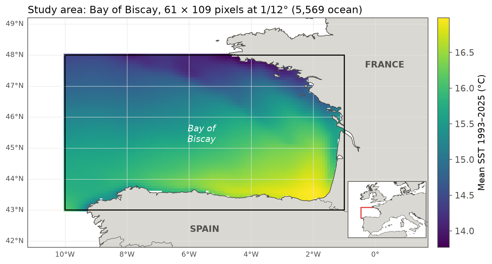
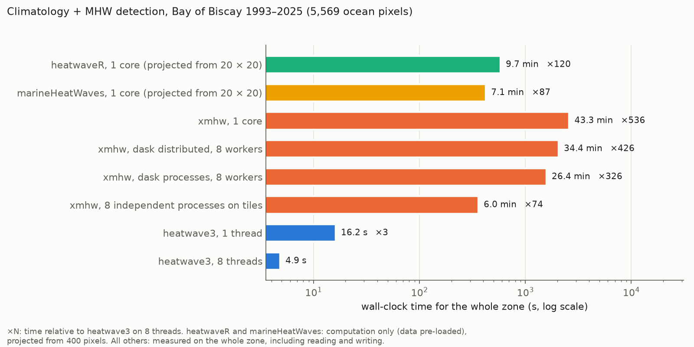
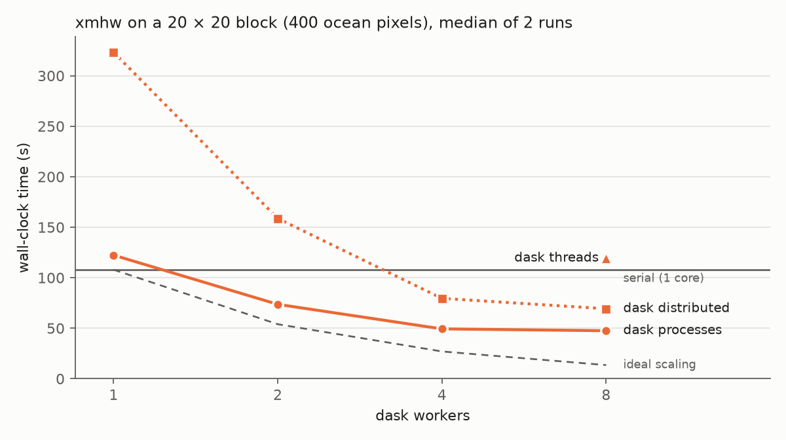

# Performance benchmark

This page compares the wall-clock time and memory of four marine heatwave
(MHW) packages that implement the Hobday et al. (2016, 2018) definition, on
the same file and the same machine, and checks that they detect the same
events. It is the Python companion of the
[benchmark article of the R package](https://robwschlegel.github.io/heatwave3/articles/benchmark_packages.html),
and shows the same results.

- **heatwave3**, C++ with `std::thread` over pixels and direct NetCDF input and
  output (the same core for Python and R);
- **heatwaveR** (R), one pixel at a time;
- **marineHeatWaves** (Python), the original implementation, one pixel at a
  time;
- **xmhw** (Python), built on xarray and dask, which can run in parallel.

## Data and settings

The input is the Copernicus Marine GLORYS12 reanalysis
(`cmems_mod_glo_phy_my_0.083deg_P1D-m`, dataset version 202311,
[doi:10.48670/moi-00021](https://doi.org/10.48670/moi-00021)), sea water
potential temperature (`thetao`, °C) at the surface level (0.494 m), for the
Bay of Biscay (10°W to 1°W, 43°N to 48°N): 61 × 109 pixels at 1/12°, of which
5,569 are ocean, with 12,053 daily values from 1993-01-01 to 2025-12-31.



All packages use a climatology over 1993 to 2022, the 90th percentile
threshold, an 11-day window, 31-day smoothing, a minimum duration of 5 days,
gaps of up to 2 days joined, and the Hobday et al. (2018) categories. The
versions are heatwave3 1.4.0 (PyPI wheel), heatwaveR 0.5.5.9000 (commit
`5777be9`), marineHeatWaves 0.28 (commit `d7292bf`) and xmhw 1.0.0, on an
Apple M2 (4 performance and 4 efficiency cores, 16 GB RAM) with Python 3.12
and R 4.6.1.

## Timing protocol

Each timed run is a fresh process, and imports are not timed. heatwave3 and
xmhw run on the whole zone, and the time includes reading the input, the
climatology, the detection and writing all outputs to NetCDF (heatwave3:
median of 3 runs after a warm-up; xmhw: one run per configuration).
heatwaveR and marineHeatWaves are too slow for the whole zone: each runs on a
20 × 20 block with the data already in memory, and the time is projected as
block time / 400 × 5,569 ocean pixels (fastest of 3 runs).

## Results



```{csv-table} Whole zone, climatology + detection. Times in s, peak RAM in GB.
:file: ../../vignettes/articles/benchmark-data/docs_totals_biscay.csv
:header-rows: 1
```

heatwave3 processes the whole zone in 4.9 s on 8 threads and in 16.2 s on
one. On a single core it is 36 times faster than heatwaveR and 160 times
faster than xmhw, even though the heatwaveR projection leaves out reading the
file. The fastest xmhw configuration on 8 cores (8 independent processes, see
below) takes 6.0 min, i.e. 74 times as long as heatwave3 on 8 threads.

## xmhw on 8 cores

xmhw parallelises over grid cells. `threshold()` builds one small dask
computation per ocean cell and `detect()` one `dask.delayed` task per cell,
each followed by a single `dask.compute()`. Chunking the input `DataArray`
therefore adds no parallelism (it only makes every task read the file
lazily), and the number of cells processed at once is set by the dask
scheduler. With no scheduler configured, dask uses its threaded scheduler on
all cores.

```{important}
Load the climatology returned by `threshold()` before passing it to
`detect()`. It is returned as lazy dask arrays carrying every cell's
computation, and when `detect()` slices them per cell, the time dask spends
optimising the task graph grows with the square of the number of cells: on
400 cells, detection took 0.72 s per cell without `.load()` and ca. 0.02 s per
cell with it.
```

```python
import dask
import xarray as xr
from xmhw.xmhw import threshold, detect

sst = xr.open_dataset("biscay_glorys12_full_1993-2025.nc")["thetao"].load()
with dask.config.set(scheduler="processes", num_workers=8):
    clim = threshold(sst, climatologyPeriod=[1993, 2022]).load()
    mhw = detect(sst, clim["thresh"], clim["seas"], minDuration=5,
                 joinGaps=True, maxGap=2)
```

The scheduler was chosen on the 20 × 20 block (400 ocean pixels), timing each
scheduler from 1 to 8 workers (median of 2 runs):



```{csv-table} xmhw on the 20 × 20 block. Times in s.
:file: ../../vignettes/articles/benchmark-data/docs_xmhw_scaling_block.csv
:header-rows: 1
```

The threaded scheduler gains nothing (119 s on 8 threads against 108 s
serial). This is because the per-cell work in xmhw is mostly Python and xarray
overhead (the climatology alone makes 366 small `quantile()` calls per cell),
which holds Python's global interpreter lock. Worker processes avoid the lock
but have to receive each cell's data and computation from the parent process.
With `dask.distributed` this transfer costs more than the work itself (323 s
on one worker), and the time then falls with more workers. The
multiprocessing scheduler has less overhead and is the fastest dask option,
at 48 s on 8 workers, but it gains little beyond 4 workers. This is
consistent with the parent process, which builds every cell's computation and
assembles the results on a single core, setting the pace, and with the M2's 4
efficiency cores being slower than its 4 performance cores.

The cost per cell also grows with the domain. Serial xmhw takes 0.24 s per
cell for the climatology on the 400-cell block but 0.44 s per cell on the
whole zone, whereas detection stays near 0.023 s per cell. This is consistent
with `threshold()` running a single `dask.compute()` over the computations of
all cells, which the parent process prepares on one core. It also explains
why, with 8 workers, the multiprocessing scheduler is 2.3 times faster than
serial on the block but only 1.6 times faster on the whole zone.

To see how fast xmhw could be on 8 cores without dask overhead, we also split
the zone into 8 latitude strips with about the same number of ocean pixels and
ran 8 serial xmhw processes at the same time. This gives 6.0 min for the whole
zone, against 43.3 min serial, 26.4 min with the multiprocessing scheduler and
34.4 min with `dask.distributed`. It leaves the output as 8 separate files,
and the 8 processes together used 15.6 GB of memory at their peak, nearly all
of the 16 GB of the test machine.

## Agreement of the detected events

On the 20 × 20 block, each package's events are paired with heatwave3's on
pixel, start date and end date, and the paired metrics compared (intensities
at 4 decimals). Percentages are of the paired events, and the last two columns
are the median and maximum absolute difference in mean intensity (°C).

```{csv-table} Events on the 20 × 20 block compared with heatwave3.
:file: ../../vignettes/articles/benchmark-data/docs_agreement_block.csv
:header-rows: 1
```

heatwaveR and heatwave3 detect the same 28,018 events. The 22 heatwaveR
events without an exact partner are the ones still running at the end of the
series, which heatwave3 ends on the last day above the threshold whereas
heatwaveR joins up to `maxGap` trailing days into them. The remaining
differences are rounding at the fourth decimal and two events whose category
falls exactly on a class boundary. marineHeatWaves and xmhw each compute their
own climatology, so their thresholds differ slightly from heatwave3's. This
means that 1.3% (marineHeatWaves) and 1.5% (xmhw) of their events start or
end on a different day, and that paired mean intensities differ by a median of
0.00003 °C for both (at most 0.002 °C and 0.003 °C). Durations agree in every
pair. Across the whole zone, xmhw finds 394,461 events against heatwave3's
394,516, with the same count in 86.9% of pixels.

## Caveats

- One machine and one region. The ratios depend on the CPU (the M2 mixes
  performance and efficiency cores), the disk and the grid size.
- The heatwaveR and marineHeatWaves times are projections that exclude
  reading the data, which favours them.
- xmhw on the whole zone is one run per configuration. On the block, the two
  runs of each configuration agreed to within 5%.
- The output formats differ (heatwave3: a CF event table and gridded
  climatology; xmhw: its climatology and an event array padded to the largest
  number of events in any cell), but both are written to NetCDF within the
  timed run.
