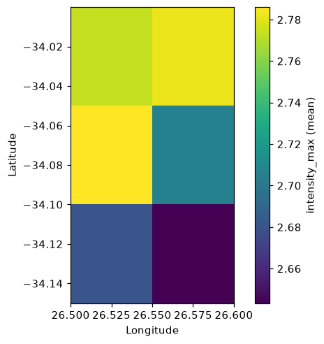
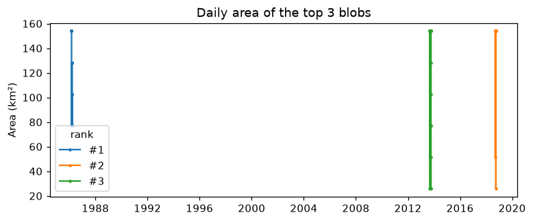

# Getting started

A typical analysis has three steps:

1. {func}`~heatwave3.ts2clm3` computes the seasonal climatology and the
   percentile threshold for every pixel and day of the year.
2. {func}`~heatwave3.detect_event3` detects the events against that
   climatology.
3. The results are read, summarised and plotted with
   {func}`~heatwave3.hw3_export`, {func}`~heatwave3.category3`,
   {func}`~heatwave3.block_average3`, {func}`~heatwave3.detect_blob3` and the
   plotting functions.

{func}`~heatwave3.detect3` runs steps 1 and 2 in one call.

The examples below use the small test file in the repository
(`inst/extdata/sst_test.nc`): daily OSTIA sea surface temperature from 1982 to
2021 on a grid of 2 × 3 pixels off the Agulhas coast. The outputs shown were
produced by `python/docs/generate_examples.py`.

## Input data

The input is daily sea surface temperature (or another variable) in NetCDF,
given as one of:

- a single NetCDF file with many time steps;
- a directory of daily `.nc` or `.nc4` files;
- a list of file paths;
- a Zarr store, local or remote (see {ref}`zarr-input`).

Variable and dimension names are detected from the CF conventions and common
naming patterns, so GHRSST, OISST, OSTIA, ERA5, CMIP6 and similar products
work without naming them. Pass `var_name` if a file holds several candidate
variables.

```python
import heatwave3 as hw3

clim = ("1982-01-01", "2011-12-31")

# One multi-year file, with a spatial subset. 'name' is a path stem:
# ts2clm3() writes benguela_clim.nc
hw3.ts2clm3("sst_merged.nc", "benguela", clim,
            lon_range=(15, 35), lat_range=(-38, -28), n_threads=4)

# A directory of daily files
hw3.ts2clm3("daily_sst/", "benguela", clim, n_threads=4)

# An explicit list of files
from pathlib import Path
files = sorted(Path("daily_sst").glob("*.nc4"))
hw3.ts2clm3(files, "benguela", clim, n_threads=4)
```

## The basic pipeline

```python
import heatwave3 as hw3

sst_file = "inst/extdata/sst_test.nc"
out = hw3.detect3(sst_file, "demo", ("1982-01-01", "2011-12-31"),
                  category=True, n_threads=2)
clim_file, event_file = out["clim"], out["events"]
```

The compute functions always write NetCDF and return the paths they wrote.
After each step they print a short summary of the product (its head, tail and
a few statistics); `quiet=True` turns this, and the progress messages, off.

(zarr-input)=
## Zarr input

Every function that reads sea surface temperature or a climatology also
accepts a Zarr store: a local path or a URL ending in `.zarr`. This needs the
optional dependencies (`s3://` URLs also need `s3fs`):

```bash
pip install 'heatwave3[zarr]'
```

On macOS 14 or earlier, add `--only-binary netCDF4`: recent netCDF4 releases
have wheels for macOS 15 or later only, and pip otherwise tries to build one
from source.

Only the region a call needs is read from the store, into a temporary NetCDF
next to the outputs that is removed afterwards. The data keep the store's own
storage type and packing, so the results are those of a NetCDF holding the
same data. Depth levels are counted from the surface down, so `depth=0` is
always the surface level, whatever the store's own convention. Zarr input is
available in Python only.

The example reads the GLORYS12 reanalysis from the public Copernicus Marine
store (no account needed), for a small area of the Bay of Biscay:

```python
import heatwave3 as hw3

glorys = ("https://s3.waw3-1.cloudferro.com/mdl-arco-geo-025/arco/"
          "GLOBAL_MULTIYEAR_PHY_001_030/cmems_mod_glo_phy_my_0.083deg_P1D-m_202311/"
          "geoChunked.zarr")
clim = ("1993-01-01", "2022-12-31")
biscay = dict(lon_range=(-5.0, -0.92), lat_range=(43.25, 47.33))

# Climatology and events in one call (surface temperature)
hw3.detect3(glorys, "biscay", clim, var_name="thetao", category=True,
            hemisphere="north", **biscay)

# Or in two steps: the climatology alone ...
hw3.ts2clm3(glorys, "biscay", clim, var_name="thetao", **biscay)

# ... then the events, from the climatology written above
hw3.detect_event3(glorys, "biscay", var_name="thetao", category=True,
                  hemisphere="north")
```

A climatology computed once can serve many later runs. It may be kept as
NetCDF or as Zarr (a heatwave3 climatology stored with xarray), and
{func}`~heatwave3.detect_event3` can work on part of it with `lon_range`,
`lat_range` and `time_range`, for example one region of a global climatology:

```python
import xarray as xr

xr.open_dataset("biscay_clim.nc").to_zarr("biscay_clim.zarr", consolidated=False)

hw3.detect_event3(glorys, "gironde", clim_file="biscay_clim.zarr",
                  var_name="thetao", lon_range=(-2.5, -1.2),
                  lat_range=(45.0, 46.0), time_range=("2020-01-01", "2024-12-31"))
```

## Reading and exporting the results

{func}`~heatwave3.hw3_export` reads any heatwave3 product into a long pandas
DataFrame, or writes it to a `.csv` or `.parquet` file. The product type is
detected from the file.

```python
events = hw3.hw3_export(event_file)
events[["lon", "lat", "event_no", "date_start", "date_end",
        "duration", "intensity_max", "category"]].head()
```

```{literalinclude} _generated/events_head.txt
:language: text
```

Passing any of `vars`, `lon_range`, `lat_range`, `time_range`, `depth_range`
or `n` reads only that part of the file from disk, so large products can be
explored cheaply:

```python
hw3.hw3_export(event_file, n=20)                       # a quick look
hw3.hw3_export("demo_events_daily.nc", vars=["temp", "category"],
               time_range=("2015-01-01", "2015-12-31"))
hw3.hw3_export(event_file, file_out="events.parquet")  # or .csv
```

## Plotting one pixel

{func}`~heatwave3.event_line3` plots the temperature, climatology and
threshold at one pixel, with the events filled in. Given `event_file` instead
of dates, it centres the plot on the pixel's strongest event.

```python
hw3.event_line3(sst_file, clim_file, lon=26.525, lat=-34.125,
                start_date="2010-01-01", end_date="2012-12-31")
```


## Maps of event metrics

{func}`~heatwave3.plot_metric3` maps any event metric, aggregated per pixel
(mean, maximum, minimum, sum or count).

```python
hw3.plot_metric3(event_file, metric="intensity_max", summary="mean")
```



The plotting functions return the matplotlib `Axes` and accept an `ax`
argument, so they can be combined into larger figures. The lower-level
{func}`~heatwave3.geom_flame3` and {func}`~heatwave3.geom_lolli3` draw flames
and lollipops onto any `Axes`.

## Categories and annual summaries

{func}`~heatwave3.category3` gives each event its Hobday et al. (2018)
category and season, exactly as `heatwaveR::category()`. The columns
`p_moderate` to `p_extreme` are the percentages of the event's days spent in
each category (whole numbers; days below the threshold within an event are not
counted, so they can add up to less than 100), and the category is the highest
one reached on at least one day.

```python
cats = hw3.category3(event_file, clim_file)
cats["category"].value_counts()
```

```{literalinclude} _generated/category_counts.txt
:language: text
```

{func}`~heatwave3.block_average3` summarises the events per pixel and year:

```python
hw3.block_average3(event_file).head()
```

```{literalinclude} _generated/block_head.txt
:language: text
```

{func}`~heatwave3.category_daily3` returns the daily categories for a date
window, without re-running detection.

## Detrended climatology

By default the climatology follows Hobday et al. (2016) with a fixed baseline.
To remove the long-term trend before computing it (as in Jacox et al. 2020):

```python
hw3.ts2clm3(sst_file, "demo_detrended", ("1982-01-01", "2011-12-31"), detrend=True)
```

## Cold-spells

For marine cold-spells, compute the climatology with the 10th percentile and
detect with `coldSpells=True`:

```python
hw3.ts2clm3(sst_file, "demo_cold", ("1982-01-01", "2011-12-31"), pctile=10)
hw3.detect_event3(sst_file, "demo_cold", coldSpells=True, category=True)
```

## Spatially connected events (blobs)

{func}`~heatwave3.detect_blob3` links exceedance days that touch in longitude,
latitude and time (and depth, for a depth-resolved climatology) into spatially
coherent events, and summarises each one overall and per day. By default only
face neighbours touch (one grid step along one axis); `connectivity=10`, `18`
or `26` adds diagonal neighbours. Its `return_` argument chooses the outputs;
the voxel table holds the full footprint.

```python
blobs = hw3.detect_blob3(sst_file, clim_file, minVoxels=20, topN=3,
                         return_=("event", "daily"))
blobs["event"][["blob", "duration", "date_start", "date_end",
                "peakArea_km2", "cumI_km2_day", "rank"]]
```

```{literalinclude} _generated/blob_events.txt
:language: text
```



On this six-pixel grid, the peak area of each blob is the whole grid; on real
domains, footprints, daily areas and centroid tracks show how events grow,
move and decay.

## Depth-resolved data

With `depth_range=(min, max)`, {func}`~heatwave3.ts2clm3` keeps those depth
levels as a dimension. Event detection, daily categories and blob detection
then work on every level, and blobs connect through the water column.

## Threads

By default each call uses half the available cores. Change this for the
session with {func}`~heatwave3.setHW3threads` or the `HEATWAVE3_NUM_THREADS`
environment variable, or for one call with `n_threads`. The same threads
compress the gridded output files.

## Compression

Output files are compressed with zlib at level 1 by default. `compression=0`
to `9` sets the level for one call: higher levels give files a few percent
smaller, and `compression=0` writes uncompressed files, several times larger
but much quicker to write. Per-day products (`daily=`, `protoEvent=True`) are
the largest files, so they gain most from this choice.
